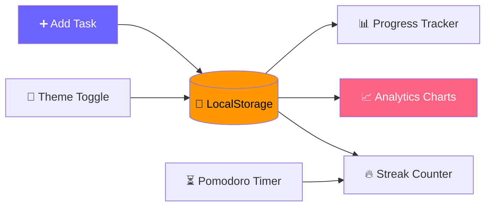

<div align="center">

# 📚 Student Study Planner

### **Plan smart. Focus deep. Stay consistent.**

*A modern student productivity web app to organize study tasks, track progress, focus with a Pomodoro timer and analyze study habits.*

<br/>


[](#-license)
[](#-contributing)


<br/>

[**Features**](#-features) •
[**Screenshots**](#-screenshots) •
[**Tech Stack**](#-tech-stack) •
[**Getting Started**](#-getting-started) •
[**Roadmap**](#-roadmap) •
[**Contributing**](#-contributing)

</div>

---

## 📖 Table of Contents

- [About](#-about)
- [Features](#-features)
- [Screenshots](#-screenshots)
- [UI / UX Highlights](#-ui--ux-highlights)
- [Tech Stack](#-tech-stack)
- [Project Structure](#-project-structure)
- [Getting Started](#-getting-started)
- [How It Works](#-how-it-works)
- [Roadmap](#-roadmap)
- [Contributing](#-contributing)
- [License](#-license)
- [Author](#-author)

---

## 🌟 About

**Student Study Planner** is a clean, dashboard-style web app built for students who want to stay organized and motivated. Add your tasks, tick them off, run focused study sessions, and watch your habits turn into charts and streaks.

It runs entirely in the browser — **no backend, no sign-up, no installation**. Your data stays on your device thanks to LocalStorage.

> 💡 **In one line:** plan your tasks → focus with Pomodoro → track your progress → keep your streak alive.

---

## 🚀 Features

<table>
<tr>
<td width="50%" valign="top">

### 📝 Task / Subject Planner
- Add and manage study tasks
- Set **subject, task name, due date and priority**
- Mark tasks as **completed**
- Delete tasks when finished
- Everything saved with **LocalStorage**

</td>
<td width="50%" valign="top">

### 📊 Daily Progress Tracker
- **Total**, **completed** and **pending** task counts
- Visual **progress indicator**
- Updates automatically as you complete tasks

</td>
</tr>
<tr>
<td width="50%" valign="top">

### ⏳ Pomodoro Focus Timer
- Built-in **25-minute** focus timer
- **Start / Pause / Reset** controls
- Break reminders
- Helps you maintain deep focus

</td>
<td width="50%" valign="top">

### 📈 Study Analytics
Interactive **Chart.js** charts:
- Completed vs Pending tasks
- Daily study activity
- Weekly productivity insights

</td>
</tr>
<tr>
<td width="50%" valign="top">

### 🔥 Study Streak System
Stay consistent by tracking daily streaks.

> 🔥 **5 Day Study Streak**

</td>
<td width="50%" valign="top">

### 🌙 Dark Mode
Switch between **Light** and **Dark** themes for comfortable studying at any time of day.

</td>
</tr>
</table>

### 🏷️ Task Priorities

| Priority | Use it for |
|:---:|---|
| 🔴 **High** | Exams, deadlines and urgent assignments |
| 🟡 **Medium** | Regular revision and homework |
| 🟢 **Low** | Optional reading and light practice |

---

## 📸 Screenshots

> 📌 Add your screenshots to `assets/screenshots/` and they will show up here.

| 🏠 Dashboard | ✅ Task Planner |
|:---:|:---:|
|  |  |

| ⏳ Pomodoro Timer | 📈 Analytics |
|:---:|:---:|
|  |  |

| 🌙 Dark Mode | 📱 Mobile View |
|:---:|:---:|
|  |  |

---

## 🎨 UI / UX Highlights

- 🧭 Modern **dashboard layout**
- ✨ Smooth **hover animations**
- 🌈 Attractive **gradient theme**
- 🗂️ Clean, readable **task cards**
- 📱 Fully **responsive** — mobile, tablet and desktop
- 🌗 Comfortable **light and dark** themes

---

## 🛠 Tech Stack

| Category | Technology |
|---|---|
| 🧱 **Structure** | HTML5 |
| 🎨 **Styling** | CSS3 (gradients, animations, responsive layout) |
| ⚙️ **Logic** | JavaScript (ES6) |
| 📊 **Charts** | [Chart.js](https://www.chartjs.org/) |
| 🔣 **Icons** | [Font Awesome](https://fontawesome.com/) |
| 🔤 **Fonts** | [Google Fonts – Poppins](https://fonts.google.com/specimen/Poppins) |
| 💾 **Storage** | Browser LocalStorage |

---

## 📂 Project Structure

```text
study-planner/
│
├── index.html          # App markup & layout
├── style.css           # Styling, themes & responsiveness
├── script.js           # Tasks, timer, analytics, streaks & dark mode
│
└── assets/
    ├── icons/
    ├── images/
    └── screenshots/    # README screenshots
```

---

## ⚡ Getting Started

No build tools required.

```bash
# 1️⃣ Clone the repository
git clone https://github.com/sangmeshwar2006/study-planner.git

# 2️⃣ Go into the project folder
cd study-planner

# 3️⃣ Open the app
# Double-click index.html, or serve it locally:
npx serve .
# or
python -m http.server 8000
```

Then visit **http://localhost:8000** (or the address your server prints).

> 💡 Chart.js, Font Awesome and Google Fonts load from the web, so keep an internet connection on the first run.

---

## 🧠 How It Works



1. You add and complete tasks — they are stored in **LocalStorage**.
2. The dashboard reads that data to update **progress** and **charts**.
3. Daily study activity feeds the **streak** counter.
4. Your **theme** choice is remembered for your next visit.

---

## 🗓️ Roadmap

- [x] Task planner with subject, due date and priority
- [x] Progress tracker
- [x] Pomodoro focus timer
- [x] Chart.js analytics
- [x] Study streaks
- [x] Dark mode
- [x] Responsive design
- [ ] User authentication
- [ ] Cloud data storage
- [ ] AI study recommendations
- [ ] Study reminders & notifications
- [ ] Mobile app version

> 💬 Got an idea? [Open an issue](https://github.com/sangmeshwar2006/study-planner/issues) — suggestions are welcome!

---

## 🤝 Contributing

Contributions are welcome!

1. 🍴 **Fork** the repository
2. 🌿 Create a new branch: `git checkout -b feature/your-feature`
3. 💾 Commit your changes: `git commit -m "Add your feature"`
4. 📤 Push the branch: `git push origin feature/your-feature`
5. 🔃 Open a **Pull Request**

---

## 📜 License

Distributed under the **MIT License**. You are free to use, modify, and distribute this software, provided the copyright notice and license text are included.

```text
MIT License

Copyright (c) 2026 Sangmeshwar

Permission is hereby granted, free of charge, to any person obtaining a copy
of this software and associated documentation files (the "Software"), to deal
in the Software without restriction, including without limitation the rights
to use, copy, modify, merge, publish, distribute, sublicense, and/or sell
copies of the Software, and to permit persons to whom the Software is
furnished to do so, subject to the following conditions:

The above copyright notice and this permission notice shall be included in all
copies or substantial portions of the Software.

THE SOFTWARE IS PROVIDED "AS IS", WITHOUT WARRANTY OF ANY KIND, EXPRESS OR
IMPLIED, INCLUDING BUT NOT LIMITED TO THE WARRANTIES OF MERCHANTABILITY,
FITNESS FOR A PARTICULAR PURPOSE AND NONINFRINGEMENT. IN NO EVENT SHALL THE
AUTHORS OR COPYRIGHT HOLDERS BE LIABLE FOR ANY CLAIM, DAMAGES OR OTHER
LIABILITY, WHETHER IN AN ACTION OF CONTRACT, TORT OR OTHERWISE, ARISING FROM,
OUT OF OR IN CONNECTION WITH THE SOFTWARE OR THE USE OR OTHER DEALINGS IN THE
SOFTWARE.
```

---

## 👨‍💻 Author

**Sangmeshwar**

Passionate about building **student productivity tools and web applications**.

[](https://github.com/sangmeshwar2006)

---

<div align="center">

### ⭐ Found this useful? Give the repository a star!

**Built with ❤️ to help students study smarter**

</div>
